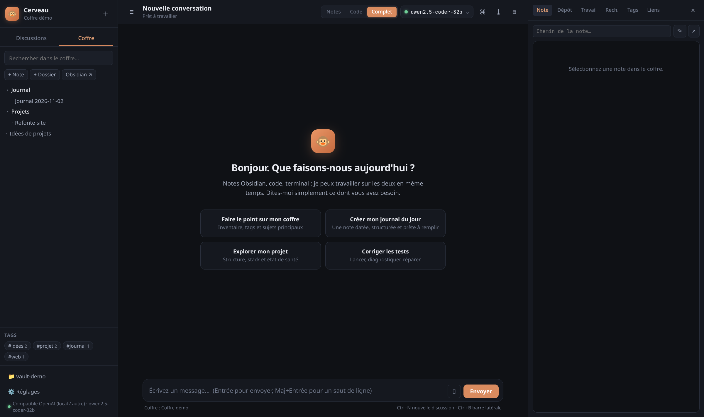
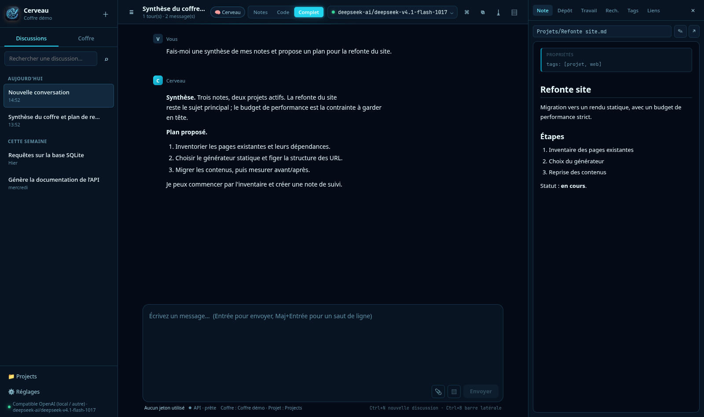
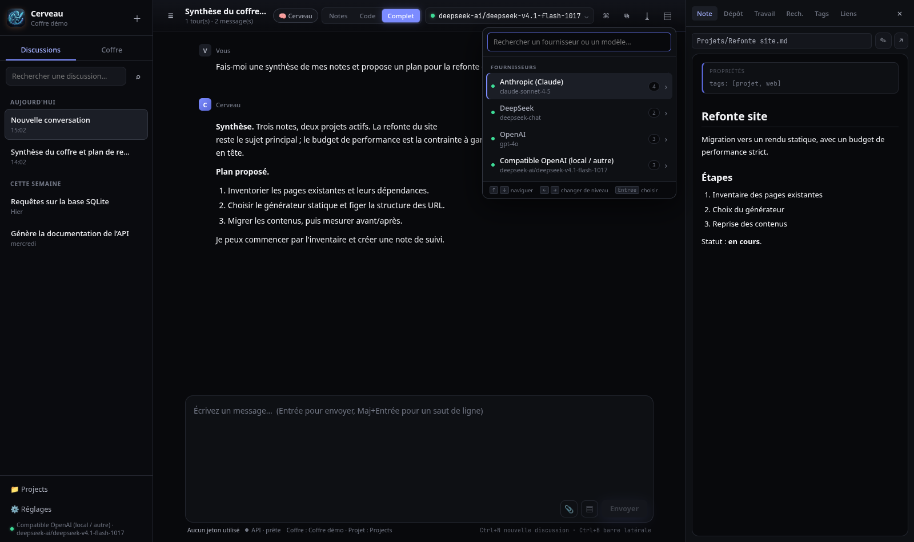
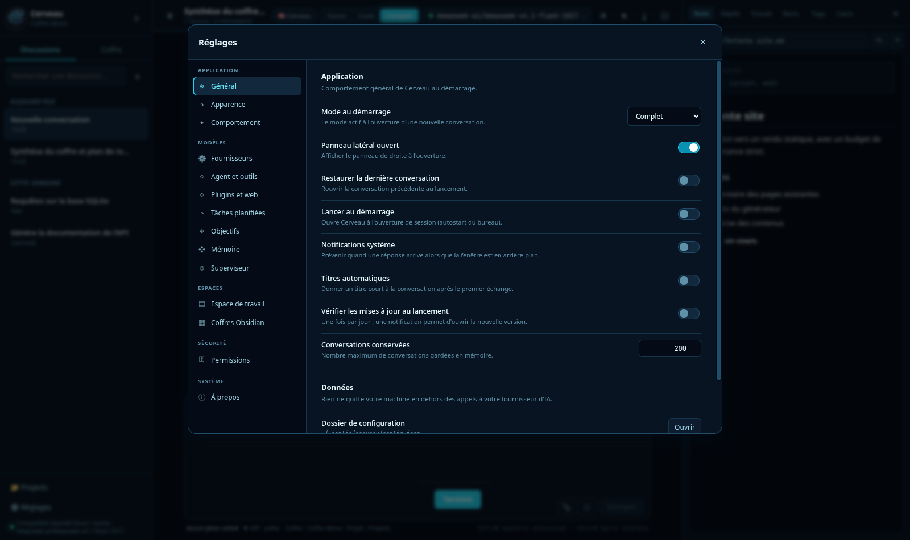
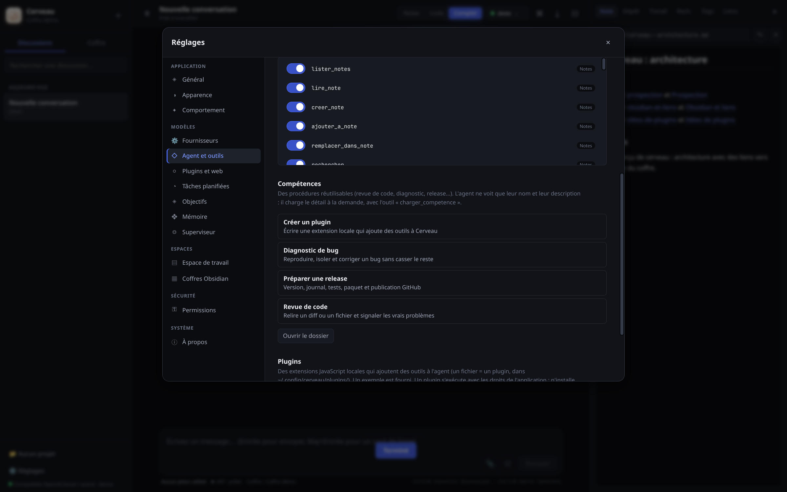
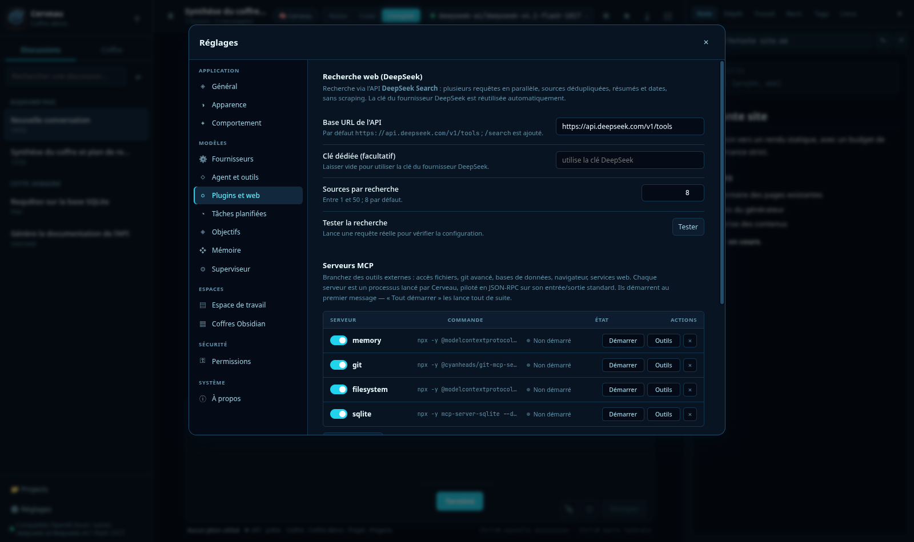

# Cerveau 🐵

**Assistant IA de bureau francophone** avec coffre **Obsidian** intégré, **agent de code**
et **intégration GitHub**. Conçu pour [Omarchy](https://omarchy.org) et Arch Linux.


Il réunit dans une seule fenêtre ce qu'on fait d'habitude dans quatre outils :

| | |
|---|---|
| 💬 **Assistant** | Claude, DeepSeek, OpenAI ou tout service compatible — plusieurs modèles par fournisseur |
| 📝 **Notes** | Ton coffre Obsidian, lu et écrit directement, sans plugin |
| ⌨️ **Code** | Un terminal et les fichiers du projet, avec plan de tâches et vérification |
| 🐙 **GitHub** | Clonage, branches, commits, push et pull requests |

---

## Aperçu

**L'accueil** — coffre, conversations et panneau de notes dans une seule fenêtre.



**Une note** — rendu Markdown, propriétés et liens, lus directement dans le dossier du coffre.



**Le sélecteur de modèle** — deux niveaux : fournisseur, puis modèle et effort de raisonnement.



**Les réglages** — navigation verticale, champs alignés, tout au même endroit.



**Agent et outils** — 36 outils, désactivables un par un.



**Plugins et web** — recherche internet et serveurs MCP externes.



---

## Ce que le paquet installe, et ce qu'il faut en plus

Le paquet `cerveau` contient l'application et son interface. **`git`** est la seule
dépendance système obligatoire.

**Requis pour les fonctions GitHub et MCP** — à installer, ou à fournir via un
gestionnaire de versions comme `mise`, `nvm` ou `asdf` (c'est pourquoi ils restent
facultatifs dans le PKGBUILD : les déclarer en dur empêcherait l'installation sur ces
systèmes) :

| Outil | Pourquoi | Installation |
|---|---|---|
| `github-cli` | Onglet Dépôt, pull requests, Superviseur | `pacman -S github-cli` |
| `nodejs` + `npm` | Serveurs MCP (`npx` les télécharge au premier usage) | `pacman -S nodejs npm` |

**Réglages → Superviseur → Outils système** affiche leur état réel, avec la commande
d'installation si quelque chose manque.

Facultatifs, non inclus :

| Outil | Pourquoi | Comment |
|---|---|---|
| `obsidian` | Ouvrir les notes dans Obsidian | `pacman -S obsidian` |
| ZIMREAPER | Navigateur piloté par l'agent (21 outils MCP) | [à compiler](https://github.com/Mr-Destroyer/ZIMREAPER) — aucune release binaire n'est publiée |

---

## Installation

### En une ligne (recommandé)

```bash
curl -fsSL https://raw.githubusercontent.com/chimprookie-group/cerveau/main/install.sh | bash
```

Le script vérifie ton système, installe les dépendances manquantes, récupère la dernière
version et **contrôle son empreinte SHA-256** avant de l'installer.

### Avec pacman

```bash
# télécharge le paquet depuis la page Releases, puis :
sudo pacman -U cerveau-2.9.1-1-x86_64.pkg.tar.zst
```

### Depuis les sources

```bash
git clone https://github.com/chimprookie-group/cerveau.git
cd cerveau
npm install
npm run dist          # construit l'archive source
cd pkg && makepkg -si # construit et installe le paquet
```

### Désinstallation

```bash
sudo pacman -R cerveau
```

Tes réglages restent dans `~/.config/cerveau/` — supprime ce dossier pour repartir de zéro.

---

## Premiers pas

### 1. Une clé d'API

`Réglages` (⚙ en bas à gauche) → **Fournisseurs**.

| Fournisseur | URL de base | Exemples de modèles |
|---|---|---|
| Anthropic | `https://api.anthropic.com` | claude-sonnet-4-5, claude-opus-4-1 |
| DeepSeek | `https://api.deepseek.com` | deepseek-chat, deepseek-reasoner |
| OpenAI | `https://api.openai.com/v1` | gpt-4o, gpt-4o-mini |
| Compatible | `http://localhost:1234/v1` | autant que tu veux |

Colle ta clé → **Enregistrer** → **Tester la connexion**.

> La clé est chiffrée en AES-256-GCM dans `~/.config/cerveau/config.json` (permissions `600`).
> Elle n'est jamais affichée en clair et ne sort que vers l'API du fournisseur choisi.

#### Plusieurs modèles

Chaque fournisseur accepte **autant de modèles que tu veux** — indispensable avec un
serveur local (LM Studio, Ollama, vLLM) qui en expose souvent plusieurs.

- **⟳ Détecter** interroge le fournisseur (`GET /v1/models`) et récupère sa vraie liste.
- **+ Ajouter** accepte un nom saisi à la main.
- **★** définit le modèle par défaut, **✕** retire un modèle ajouté.

Le sélecteur en haut à droite liste ensuite tous ces modèles ; le choix y est **propre
à la session**, sans modifier ton défaut.

### 2. Ton coffre Obsidian

`Réglages` → **Coffres** → **Ajouter un coffre…**, puis choisis le dossier qui contient
`.obsidian`.

Cerveau écrit **directement dans les fichiers `.md`** : Obsidian détecte les changements
et recharge les notes à chaud. Aucun plugin, aucune synchronisation.

### 3. Un projet (mode Code)

`Réglages` → **Espace de travail** → **Choisir un dossier…**

C'est le seul endroit où l'IA peut agir. Toute commande ou écriture hors de ce dossier
est refusée.

### 4. GitHub (optionnel)

Panneau **Dépôt** → **Se connecter à GitHub** → colle un jeton personnel
([github.com/settings/tokens/new](https://github.com/settings/tokens/new), portées
`repo`, `read:org`, `workflow`).

Le jeton est confié au CLI `gh`, qui le range dans le keyring système — Cerveau ne le
conserve pas.

---

## Les trois modes

| Mode | Ce que l'IA peut faire |
|---|---|
| **Notes** | Uniquement le coffre Obsidian |
| **Code** | Terminal, fichiers, recherche **et GitHub** |
| **Complet** | Les trois — mode par défaut |

Le sélecteur est en haut à droite. Les suggestions de l'écran d'accueil s'adaptent au mode.

---

## La palette de commandes

`Ctrl+K` (ou le bouton ⌘ dans l'en-tête) ouvre un accès clavier à 20 actions et à la
recherche directe dans tes notes. Navigation aux flèches, recherche insensible aux accents.

---

## Ce que l'IA sait faire

### Dans le coffre Obsidian

`lister_notes` · `lire_note` · `creer_note` · `ajouter_a_note` · `remplacer_dans_note` ·
`rechercher` · `lister_tags` · `notes_par_tag` · `liens_de_note` · `deplacer_note` ·
`creer_dossier` · `supprimer_note` · `journal_du_jour` · `statistiques_coffre`

### Dans le projet

`executer_commande` · `lister_fichiers` · `lire_fichier` · `ecrire_fichier` ·
`modifier_fichier` · `chercher_code` · `plan_taches`

Jusqu'à **25 tours** (réglable dans *Agent et outils*) : l'IA exécute, lit le résultat, corrige, recommence. Le terminal
tourne avec `pipefail`, donc un `npm test | tail` renvoie bien le code d'échec réel.

### Sur GitHub

`etat_depot` · `historique_commits` · `voir_differences` · `lister_branches` ·
`tirer_depot` · `changer_branche` · `commiter_et_pousser` · `lister_depots_github` ·
`lister_pull_requests` · `details_pull_request` · `creer_pull_request` ·
`lister_issues` · `etat_ci`

### Sur le web

`web_search` — recherche DuckDuckGo, sans clé ni configuration. Un fournisseur externe
compatible Tavily peut être branché dans les réglages.

`web_fetch` — récupère une page et la convertit en texte lisible.

### Plugins externes (MCP)

Cerveau parle le **Model Context Protocol** : chaque serveur est un processus lancé par
l'application et piloté en JSON-RPC sur son entrée/sortie standard. Tout serveur MCP
fonctionne — accès fichiers, git avancé, bases de données, navigateur, services web.

Réglages → Plugins et web → ajoute une commande (`npx`, un binaire, ce que tu veux) et
ses arguments. Les outils du serveur apparaissent préfixés (`mcp_<serveur>_<outil>`) et
sont disponibles dans les trois modes. Les serveurs démarrent en parallèle, sont arrêtés
proprement à la fermeture, et un serveur défaillant n'empêche jamais d'envoyer un message.

---

## Permissions

Trois modes, dans `Réglages → Permissions` :

- **Me demander avant chaque action** (défaut) — une fenêtre affiche la commande exacte
  ou le contenu du fichier avant validation.
- **Autoriser automatiquement** — pour un usage fluide en confiance.
- **Lecture seule** — l'IA consulte tout, mais ne modifie rien.

Le **push** et les **actions GitHub** (PR, issues) ont leurs propres verrous, indépendants
du mode automatique : ils demandent toujours confirmation, sauf case dédiée cochée.

---

## Sécurité

Cerveau manipule ton code et tes notes, donc les garde-fous sont explicites :

- **Cloisonnement strict** — le coffre et l'espace de travail sont deux périmètres
  séparés. Un chemin qui en sort (`../../etc/passwd`) est refusé.
- **Commandes destructrices bloquées** quoi qu'il arrive : `rm -rf /`, `rm -rf ~`,
  `mkfs`, `dd of=/dev/sda`, bombes fork, `shutdown`, `curl … | bash`.
- **Clés chiffrées** en AES-256-GCM, dérivées de la machine.
- **Isolation Electron** : `contextIsolation`, pas de `nodeIntegration`, pont `preload`
  explicite, CSP stricte.
- **Rendu Markdown assaini** par DOMPurify : une note piégée ne peut pas exécuter de code.
- **Aucune télémétrie.** Aucune requête réseau hors de l'API que tu as configurée.

---

## Raccourcis

| Raccourci | Action |
|---|---|
| `Ctrl+K` | Palette de commandes |
| `Ctrl+N` | Nouvelle conversation |
| `Ctrl+B` | Basculer la barre latérale |
| `Ctrl+Maj+B` | Basculer le panneau latéral |
| `Ctrl+,` | Réglages |
| `Entrée` | Envoyer · `Maj+Entrée` saut de ligne |
| `Ctrl+S` | Enregistrer la note en cours d'édition |

---

## Structure du projet

```
cerveau/
├── electron/          Processus principal
│   ├── main.js        Fenêtre, menus, IPC
│   ├── preload.js     Pont sécurisé
│   ├── config.js      Configuration + chiffrement des clés
│   ├── providers.js   Streaming SSE Anthropic / OpenAI-compatible
│   ├── models.js      Découverte des modèles (/v1/models)
│   ├── tools.js       Outils Obsidian
│   ├── codetools.js   Outils de code
│   ├── github.js      Intégration GitHub
│   ├── githubtools.js Outils GitHub
│   ├── agent.js       Boucle agentique et permissions
│   └── obsidian.js    Moteur de coffre
├── src/               Interface (HTML/CSS/JS)
├── pkg/               PKGBUILD, .desktop, AppStream, icône SVG
├── scripts/           dist.sh (archive), release.sh (publication)
├── install.sh         Installateur en une ligne
└── CHANGELOG.md
```

---

## Développement

```bash
npm install
npm start                      # lance l'application
CERVEAU_SELFTEST=1 npm start   # autotest (88 vérifications)
npm run dist                   # archive source distribuable
npm run pkg                    # archive + paquet Arch
```

L'autotest vérifie l'interface, le chiffrement, le moteur Obsidian, les outils de code,
GitHub, la palette de commandes et les métadonnées — puis contrôle par empreinte SHA-256
que la configuration réelle n'a pas été modifiée.

---

## Limites connues

- Le terminal ne gère pas les programmes interactifs (`vim`, `htop`).
- La détection de modèles dépend du fournisseur : certains ne publient pas `/v1/models`.
- L'intégration GitHub exige un jeton personnel ; l'OAuth par navigateur n'est pas géré.
- Les conflits de fusion git ne sont pas résolus automatiquement — l'IA les signale.
- Un conflit d'écriture simultanée sur la même note avec Obsidian n'est pas arbitré.

---

## Contribuer

Les rapports de bug et propositions passent par les
[issues](https://github.com/chimprookie-group/cerveau/issues).
Merci d'indiquer ta version (`Réglages → À propos`) et les étapes de reproduction.

---

## Licence

[MIT](LICENSE) — utilise librement, modifie, redistribue.
