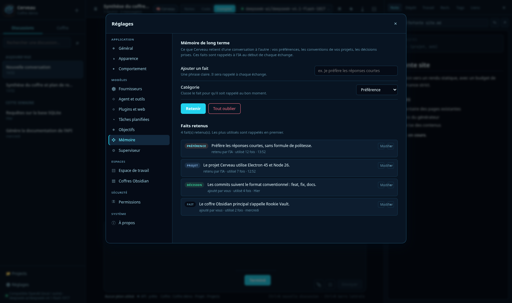
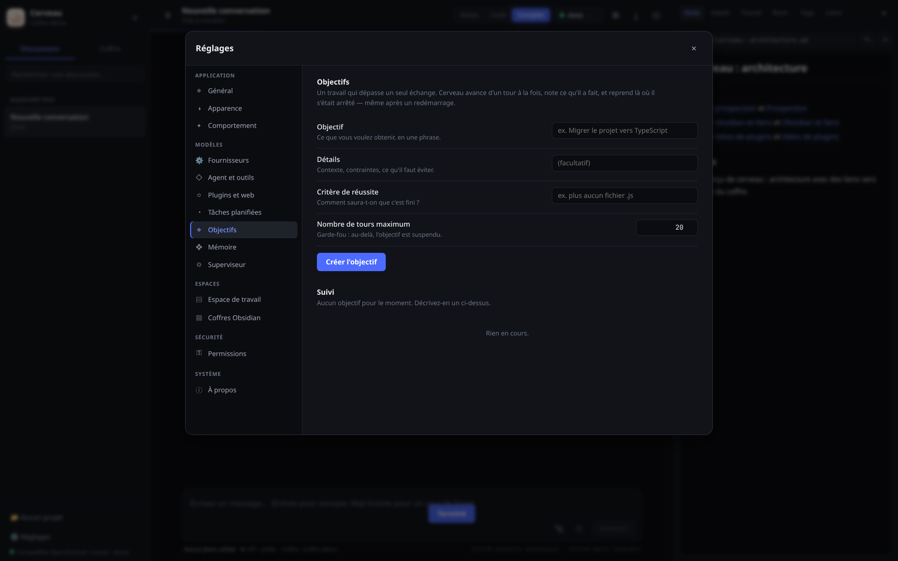
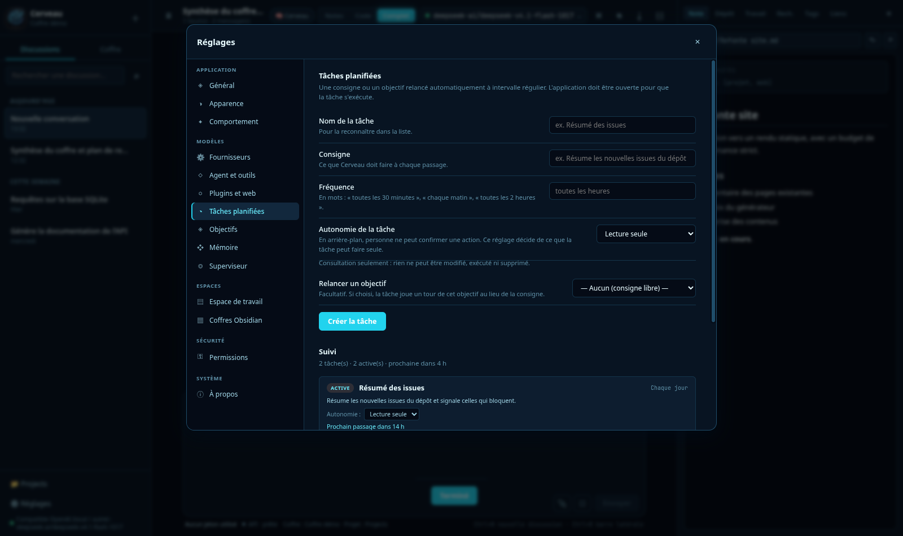

# Cerveau 🐵

**Assistant IA de bureau francophone** avec coffre **Obsidian** intégré, **agent de code**
et **intégration GitHub**. Conçu pour [Omarchy](https://omarchy.org) et Arch Linux.


Il réunit dans une seule fenêtre ce qu'on fait d'habitude dans quatre outils :

| | |
|---|---|
| 💬 **Assistant** | Claude, DeepSeek, OpenAI ou tout service compatible — plusieurs modèles par fournisseur |
| 📝 **Notes** | Ton coffre Obsidian, lu et écrit directement, sans plugin |
| ⌨️ **Code** | Un terminal et les fichiers du projet, avec plan de tâches et vérification |
| 🐙 **GitHub** | Clonage, branches, commits, push et pull requests |

---

## Aperçu

**L'accueil** — coffre, conversations et panneau de notes dans une seule fenêtre.


**Une note** — rendu Markdown, propriétés et liens, lus directement dans le dossier du coffre.


**Le sélecteur de modèle** — deux niveaux : fournisseur, puis modèle et effort de raisonnement.


**Statistiques sous le chat** — jetons consommés (entrée ↑ / sortie ↓) et état du
dernier appel API (latence, en cours, erreur), cumulés par conversation et
conservés au redémarrage.

**Réflexion en direct** — pendant une requête, une ligne en fin de conversation
indique « Réflexion approfondie depuis 12 s ··· », puis « Exécution de <outil> »
quand un outil tourne, et se fige en « Terminé en … » à la fin.

**Navigation entre les tours** — un rail de points à droite de la conversation,
un par échange : le point actif suit le défilement, le tour en cours clignote,
le survol montre l'aperçu du message et de la réponse, et un clic saute au tour.

**Confort de rédaction** — brouillons conservés par conversation, bouton
« Régénérer » sous la dernière réponse, et retour en bas dès qu'on remonte le fil.

**Sept thèmes** — **DeepSeek** (sombre neutre, bleu, par défaut), Sombre (cuivré),
Clair, **Matrix** (vert terminal), **Capucine** (crème et orange), **Nord** (bleu
arctique) et **Améthyste** (violet profond), à choisir dans
`Réglages → Apparence` ou en les faisant défiler depuis la palette de commandes.

**Intégration système** — lancement au démarrage, notifications de fin de
réponse en arrière-plan, vérification des mises à jour depuis À propos, journal
de crash dans `agent.log`.

**Les réglages** — navigation verticale, champs alignés, tout au même endroit.


**Effets visuels** — halo animé derrière l'accueil, grille fine, lueurs des contrôles
actifs. Discrets, désactivables dans *Apparence*, et coupés automatiquement si le
système demande de réduire les animations.

**Agent et outils** — 47 outils de base en mode complet (23 en notes, 33 en code,
plus les outils des plugins locaux),
désactivables un par un.


**Plugins et web** — recherche internet et serveurs MCP, avec leur état réel et
leurs outils consultables.


**Mémoire de long terme** — ce que Cerveau retient d'une conversation à l'autre :
préférences, conventions de projet, décisions.



**Objectifs** — un travail qui dépasse un seul échange. Cerveau avance d'un tour à la
fois, note ce qu'il a fait et reprend là où il s'est arrêté.



**Tâches planifiées** — une consigne ou un objectif relancé automatiquement, avec un
niveau d'autonomie réglable par tâche.



---

## Tâches planifiées en arrière-plan

Par défaut, les tâches planifiées ne tournent **que si Cerveau est ouvert**. Pour
qu'elles s'exécutent en permanence, installez le démon — un service *utilisateur*
systemd, sans root :

```bash
cerveau-daemon-install            # installe et démarre
cerveau-daemon-install --etat     # état du service
cerveau-daemon-install --retirer  # désactive et retire
```

| Commande | Effet |
|---|---|
| `journalctl --user -u cerveau-daemon -f` | suivre les exécutions |
| `cerveau-daemon --etat` | état des tâches |
| `cerveau-daemon --une-fois` | exécuter ce qui est dû, puis sortir |

Le démon **cède la place à l'application** : s'il détecte que Cerveau est ouvert,
il se met en veille pour éviter de doubler les appels à l'IA. Il tourne en
**lecture seule** pour les actions qui demanderaient une confirmation, puisque
personne ne peut répondre en arrière-plan.

---

## Ce que le paquet installe, et ce qu'il faut en plus

Le paquet `cerveau` contient l'application et son interface. **`git`** est la seule
dépendance système obligatoire.

**Requis pour les fonctions GitHub et MCP** — à installer, ou à fournir via un
gestionnaire de versions comme `mise`, `nvm` ou `asdf` (c'est pourquoi ils restent
facultatifs dans le PKGBUILD : les déclarer en dur empêcherait l'installation sur ces
systèmes) :

| Outil | Pourquoi | Installation |
|---|---|---|
| `github-cli` | Onglet Dépôt, pull requests, Superviseur | `pacman -S github-cli` |
| `nodejs` + `npm` | Serveurs MCP (`npx` les télécharge au premier usage) | `pacman -S nodejs npm` |

**Réglages → Superviseur → Outils système** affiche leur état réel, avec la commande
d'installation si quelque chose manque.

Facultatifs, non inclus :

| Outil | Pourquoi | Comment |
|---|---|---|
| `obsidian` | Ouvrir les notes dans Obsidian | `pacman -S obsidian` |

---

## Installation

### En une ligne (recommandé)

```bash
curl -fsSL https://raw.githubusercontent.com/chimprookie-group/cerveau/main/install.sh | bash
```

Le script vérifie ton système, installe les dépendances manquantes, récupère la dernière
version et **contrôle son empreinte SHA-256** avant de l'installer.

### Avec pacman

```bash
# télécharge le paquet depuis la page Releases, puis :
sudo pacman -U cerveau-2.31.0-1-x86_64.pkg.tar.zst
```

### Depuis les sources

```bash
git clone https://github.com/chimprookie-group/cerveau.git
cd cerveau
npm install
npm run dist          # construit l'archive source
cd pkg && makepkg -si # construit et installe le paquet
```

### Désinstallation

```bash
sudo pacman -R cerveau
```

Tes réglages restent dans `~/.config/cerveau/` — supprime ce dossier pour repartir de zéro.

---

## Premiers pas

### 1. Une clé d'API

`Réglages` (⚙ en bas à gauche) → **Fournisseurs**.

| Fournisseur | URL de base | Exemples de modèles |
|---|---|---|
| Anthropic | `https://api.anthropic.com` | claude-sonnet-4-5, claude-opus-4-1 |
| DeepSeek | `https://api.deepseek.com` | deepseek-chat, deepseek-reasoner |
| OpenAI | `https://api.openai.com/v1` | gpt-4o, gpt-4o-mini |
| Compatible | `http://localhost:1234/v1` | autant que tu veux |

Colle ta clé, puis **Entrée** ou **Enregistrer**. **Tester la connexion** enregistre
d'abord la carte, inutile donc de cliquer sur Enregistrer avant.

> Un serveur local (LM Studio, Ollama, vLLM) n'a pas besoin de clé : renseigne
> seulement l'URL de base.
> La clé est chiffrée en AES-256-GCM dans `~/.config/cerveau/config.json` (permissions `600`).
> Elle n'est jamais affichée en clair et ne sort que vers l'API du fournisseur choisi.

#### Plusieurs modèles

Chaque fournisseur accepte **autant de modèles que tu veux** — indispensable avec un
serveur local (LM Studio, Ollama, vLLM) qui en expose souvent plusieurs.

- **⟳ Détecter** interroge le fournisseur (`GET /v1/models`) et récupère sa vraie liste.
- **+ Ajouter** accepte un nom saisi à la main.
- **★** définit le modèle par défaut, **✕** retire un modèle ajouté.

Le sélecteur en haut à droite liste ensuite tous ces modèles ; le choix y est **propre
à la session**, sans modifier ton défaut.

### 2. Ton coffre Obsidian

`Réglages` → **Coffres** → **Ajouter un coffre…**, puis choisis le dossier qui contient
`.obsidian`.

Cerveau écrit **directement dans les fichiers `.md`** : Obsidian détecte les changements
et recharge les notes à chaud. Aucun plugin, aucune synchronisation.

### 3. Un projet (mode Code)

`Réglages` → **Espace de travail** → **Choisir un dossier…**

C'est le seul endroit où l'IA peut agir. Toute commande ou écriture hors de ce dossier
est refusée.

### 4. GitHub (optionnel)

Panneau **Dépôt** → **Se connecter à GitHub** → colle un jeton personnel
([github.com/settings/tokens/new](https://github.com/settings/tokens/new), portées
`repo`, `read:org`, `workflow`).

Le jeton est confié au CLI `gh`, qui le range dans le keyring système — Cerveau ne le
conserve pas.

---

## Les trois modes

| Mode | Ce que l'IA peut faire |
|---|---|
| **Notes** | Uniquement le coffre Obsidian |
| **Code** | Terminal, fichiers, recherche **et GitHub** |
| **Complet** | Les trois — mode par défaut |

Le sélecteur est en haut à droite. Les suggestions de l'écran d'accueil s'adaptent au mode.

---

## La palette de commandes

`Ctrl+K` (ou le bouton ⌘ dans l'en-tête) ouvre un accès clavier à 20 actions et à la
recherche directe dans tes notes. Navigation aux flèches, recherche insensible aux accents.

---

## Ce que l'IA sait faire

### Dans le coffre Obsidian

`lister_notes` · `lire_note` · `creer_note` · `ajouter_a_note` · `remplacer_dans_note` ·
`rechercher` · `lister_tags` · `notes_par_tag` · `liens_de_note` · `deplacer_note` ·
`creer_dossier` · `supprimer_note` · `journal_du_jour` · `statistiques_coffre`

### Dans le projet

`executer_commande` · `lister_fichiers` · `lire_fichier` · `ecrire_fichier` ·
`modifier_fichier` · `chercher_code` · `plan_taches`

Jusqu'à **25 tours** (réglable dans *Agent et outils*) : l'IA exécute, lit le résultat, corrige, recommence. Le terminal
tourne avec `pipefail`, donc un `npm test | tail` renvoie bien le code d'échec réel.

### Sur GitHub

`etat_depot` · `historique_commits` · `voir_differences` · `lister_branches` ·
`tirer_depot` · `changer_branche` · `commiter_et_pousser` · `lister_depots_github` ·
`lister_pull_requests` · `details_pull_request` · `creer_pull_request` ·
`lister_issues` · `etat_ci`

### Sur le web

`web_search` — recherche DuckDuckGo, sans clé ni configuration. Un fournisseur externe
compatible Tavily peut être branché dans les réglages.

`web_fetch` — récupère une page et la convertit en texte lisible.

Ces deux outils sont **intégrés à l'application** : aucun serveur MCP ni paquet à
installer. Ils se désactivent un par un dans `Réglages → Agent → Outils`.

### Plugins

Des **extensions JavaScript locales** vivent dans `~/.config/cerveau/plugins/`, un
fichier par plugin. Chaque plugin expose des outils (`plugin_<fichier>_<outil>`)
disponibles dans tous les modes. Un exemple est fourni au premier démarrage.

`Réglages → Agent et outils → Plugins` liste les plugins, leurs outils et leurs
erreurs, et permet de **recharger**, **ouvrir le dossier**, **retirer** ou
**créer** un plugin (formulaire avec code pré-rempli). Une compétence « Créer un
plugin » aide l'agent à rédiger le code.

> Un plugin s'exécute avec les droits de l'application : n'installe que du code
> que tu as lu ou écrit.

### Compétences

Des **procédures réutilisables** vivent dans `~/.config/cerveau/competences/`, un
dossier par compétence avec un `SKILL.md`. Trois sont fournies : revue de code,
diagnostic de bug et préparation de release.

Le prompt n'annonce que le nom et la description ; l'agent charge le détail à la
demande (`charger_competence`) et peut enregistrer une nouvelle procédure
(`enregistrer_competence`). Tu peux les consulter dans `Réglages → Agent → Outils`.

### Performance

- **Outils en lecture exécutés en parallèle** (réglage « Appels d'outils en
  parallèle ») : lire trois fichiers prend le temps d'un seul.
- **Compactage du contexte** : au-delà de 24 messages ou 60 000 caractères, les
  échanges anciens sont résumés par le modèle et réinjectés ; l'historique reste
  affiché, seul l'envoi est allégé.
- **Réessais automatiques** sur les erreurs passagères (429, 5xx) avant le flux.
- **Poursuite automatique** : si le modèle s'arrête avant la fin (réponse coupée,
  plan incomplet, outil en échec), l'agent reprend seul au lieu d'attendre que
  l'utilisateur écrive « continue ».
- **Vérification de fin de tâche** : après un tour qui a exécuté des outils, un
  appel court demande au modèle si la demande est réellement satisfaite ; s'il
  répond non, l'agent poursuit. Une seule vérification par demande.
- **Contexte borné pendant l'exécution** : les anciens résultats d'outils sont
  allégés au-delà d'un budget, et une erreur de contexte du fournisseur déclenche
  un allègement puis un nouvel essai.
- **Journal de diagnostic** : `~/.config/cerveau/agent.log` garde les 200 dernières
  fins de requête (modèle, erreur, outils, taille).
- **Root via pkexec** : les commandes qui exigent les droits administrateur passent
  par `pkexec` (fenêtre de mot de passe du système), jamais par un `sudo` sans
  terminal. `sudo` est converti automatiquement, et l'outil accepte
  `privileges: true`.

### Voir les images

`voir_image` — ouvre une capture d'écran, un schéma ou une photo du coffre ou de
l'espace de travail et la montre au modèle (PNG, JPEG, WebP, GIF, 4 Mo max). Pratique
pour « corrige ce rendu », « lis ce graphique » ou « compare ces deux maquettes ».

### Tâches de fond

`lancer_tache_fond` démarre un serveur de développement, un build ou une suite de tests
sans bloquer la conversation. `lister_taches_fond`, `sortie_tache_fond` et
`arreter_tache_fond` suivent la sortie et arrêtent le processus **avec ses enfants**.
Les processus apparaissent dans le panneau **Travail**, avec leur sortie et un bouton
d'arrêt ; ils sont tués à la fermeture de l'application.

### Plugins externes (MCP)

Cerveau parle le **Model Context Protocol** : chaque serveur est un processus lancé par
l'application et piloté en JSON-RPC sur son entrée/sortie standard. Tout serveur MCP
fonctionne — accès fichiers, git avancé, bases de données, navigateur, services web.
Les commandes (`npx`, `node`…) sont retrouvées même si le PATH du lanceur est pauvre,
et le tableau des serveurs propose **Tout démarrer** avec le détail des échecs.

Réglages → Plugins et web → ajoute une commande (`npx`, un binaire, ce que tu veux) et
ses arguments. Les outils du serveur apparaissent préfixés (`mcp_<serveur>_<outil>`) et
sont disponibles dans les trois modes. Les serveurs démarrent en parallèle, sont arrêtés
proprement à la fermeture, et un serveur défaillant n'empêche jamais d'envoyer un message.

---

## Permissions

Trois modes, dans `Réglages → Permissions` :

- **Me demander avant chaque action** (défaut) — une fenêtre affiche la commande exacte
  ou le contenu du fichier avant validation.
- **Autoriser automatiquement** — pour un usage fluide en confiance.
- **Lecture seule** — l'IA consulte tout, mais ne modifie rien.

Le **push** et les **actions GitHub** (PR, issues) ont leurs propres verrous, indépendants
du mode automatique : ils demandent toujours confirmation, sauf case dédiée cochée.

---

## Sécurité

Cerveau manipule ton code et tes notes, donc les garde-fous sont explicites :

- **Cloisonnement strict** — le coffre et l'espace de travail sont deux périmètres
  séparés. Un chemin qui en sort (`../../etc/passwd`) est refusé.
- **Commandes destructrices bloquées** quoi qu'il arrive : `rm -rf /`, `rm -rf ~`,
  `mkfs`, `dd of=/dev/sda`, bombes fork, `shutdown`, `curl … | bash`.
- **Clés chiffrées** en AES-256-GCM, dérivées de la machine.
- **Isolation Electron** : `contextIsolation`, pas de `nodeIntegration`, pont `preload`
  explicite, CSP stricte.
- **Rendu Markdown assaini** par DOMPurify : une note piégée ne peut pas exécuter de code.
- **Aucune télémétrie.** Aucune requête réseau hors de l'API que tu as configurée.

---

## Raccourcis

| Raccourci | Action |
|---|---|
| `Ctrl+K` | Palette de commandes |
| `Ctrl+N` | Nouvelle conversation |
| `Ctrl+B` | Basculer la barre latérale |
| `Ctrl+Maj+B` | Basculer le panneau latéral |
| `Ctrl+,` | Réglages |
| `Entrée` | Envoyer · `Maj+Entrée` saut de ligne |
| `Ctrl+S` | Enregistrer la note en cours d'édition |

---

## Structure du projet

```
cerveau/
├── electron/          Processus principal
│   ├── main.js        Fenêtre, menus, IPC
│   ├── preload.js     Pont sécurisé
│   ├── config.js      Configuration + chiffrement des clés
│   ├── providers.js   Streaming SSE Anthropic / OpenAI-compatible
│   ├── models.js      Découverte des modèles (/v1/models)
│   ├── tools.js       Outils Obsidian
│   ├── codetools.js   Outils de code
│   ├── github.js      Intégration GitHub
│   ├── githubtools.js Outils GitHub
│   ├── agent.js       Boucle agentique et permissions
│   └── obsidian.js    Moteur de coffre
├── src/               Interface (HTML/CSS/JS)
├── pkg/               PKGBUILD, .desktop, AppStream, icône SVG
├── scripts/           dist.sh (archive), release.sh (publication)
├── install.sh         Installateur en une ligne
└── CHANGELOG.md
```

---

## Développement

```bash
npm install
npm start                      # lance l'application
CERVEAU_SELFTEST=1 npm start   # autotest (88 vérifications)
npm run dist                   # archive source distribuable
npm run pkg                    # archive + paquet Arch
```

L'autotest vérifie l'interface, le chiffrement, le moteur Obsidian, les outils de code,
GitHub, la palette de commandes et les métadonnées — puis contrôle par empreinte SHA-256
que la configuration réelle n'a pas été modifiée.

---

## Limites connues

- Le terminal ne gère pas les programmes interactifs (`vim`, `htop`).
- La détection de modèles dépend du fournisseur : certains ne publient pas `/v1/models`.
- L'intégration GitHub exige un jeton personnel ; l'OAuth par navigateur n'est pas géré.
- Les conflits de fusion git ne sont pas résolus automatiquement — l'IA les signale.
- Un conflit d'écriture simultanée sur la même note avec Obsidian n'est pas arbitré.

---

## Contribuer

Les rapports de bug et propositions passent par les
[issues](https://github.com/chimprookie-group/cerveau/issues).
Merci d'indiquer ta version (`Réglages → À propos`) et les étapes de reproduction.

---

## Licence

[MIT](LICENSE) — utilise librement, modifie, redistribue.
